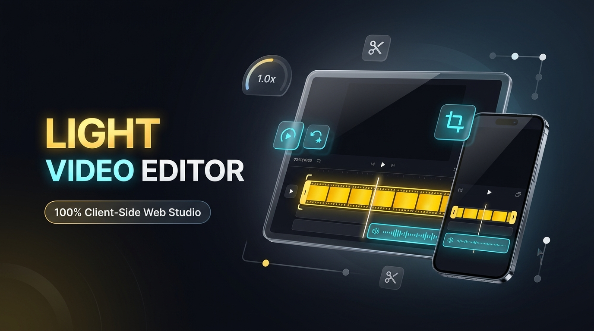

<div align="center">

# 🎬 Light Video Editor (Web Studio)

[](https://rayhanalshorif133.github.io/light-Video-Editor/)
[](LICENSE)
[](https://rayhanalshorif133.github.io/light-Video-Editor/)
[](https://github.com/rayhanalshorif133/light-Video-Editor/pulls)

<br/>



<br/>

**A fast, lightweight, and modern in-browser video editing studio.**  
Runs 100% on the client side with zero server dependencies, keeping your media completely private on your own device.

👉 **[Launch Online Editor Now](https://rayhanalshorif133.github.io/light-Video-Editor/)**

</div>

---

## ✨ Features & Capabilities

- **⚡ 100% In-Browser & Private:** Zero video uploads to external servers. All cuts, transforms, audio processing, and rendering happen right inside your browser.
- **🔗 Multi-Video Clip Import & Merge:** Add multiple video files onto the timeline via `+ Add Clip` or drag-and-drop, and seamlessly merge/stitch them into one continuous video file upon export.
- **🔀 Drag & Drop Timeline Reorder:** Effortlessly reorder clips on the timeline by dragging them with the mouse, touch handle, or using quick keyboard shortcuts (`Alt + ← / →`).
- **📑 1-Click Clip Duplication:** Clone/duplicate any selected clip with all current crop, zoom, speed, rotation, flip, and volume settings preserved (`Duplicate` button or `D`).
- **✂️ Precision Cut & Split:** Cut or split video clips exactly at the center needle playhead position using the `][ Cut` button or keyboard shortcuts (`C` or `S`).
- **🎚️ Multi-Clip Timeline Filmstrip:** Real-time thumbnail preview extraction across every clip in the timeline with auto-caching.
- **🔄 Rotate & Flip:**
  - **Rotate 90°:** Instant 90° clockwise rotations (`0°`, `90°`, `180°`, `270°`) with real-time preview (Shortcut: `R`).
  - **Flip Horizontal (Mirror):** Mirror clips horizontally (Shortcut: `H`).
  - **Flip Vertical:** Invert clips vertically.
  - **Reset Transform:** One-click reset to original orientation.
- **📐 Crop, 4-Side Screen Trimming & Fit Mode:**
  - **4-Side Custom Trimming:** Precise screen cropping from all 4 sides (Up/Top, Down/Bottom, Left, Right) using interactive on-screen drag handles or fine sliders.
  - **1:1 Square Shape Selection:** 1-click automatic square calculation to select and keep any portion of the video in a perfect square shape with draggable positioning.
  - **Aspect Ratios:** `Original`, `16:9` (YouTube / Widescreen), `9:16` (Shorts / Reels / TikTok), `1:1` (Square Instagram), `4:5` (Social Feed), and `21:9` (Ultrawide Cinema).
  - **Fit Styles:** `Fit (Contain)` with clean letterbox, or `Crop to Fill` for borderless edge-to-edge framing.
  - **Zoom / Punch-In:** Smooth 100% to 300% zoom controls.
- **⚡ Speed Control (10% to 200%):** Fine-tune playback speed from extreme slow-mo (10%) to hyperlapse (200%) with step buttons and quick presets.
- **🔊 Volume Adjustment:** Boost or mute clip volume from 0% to 200%.
- **🔁 Reverse Clip Playback:** 1-click toggle to play any clip in reverse.
- **📸 Take Snapshot / Screenshot:** Capture instant high-resolution frame snapshots at the playhead position with all rotations, flips, and framing intact. Includes 1-click PNG download and direct copy-to-clipboard (Shortcut: `P`).
- **🎞️ Animated GIF Export:** Export any fun segment, active clip, or entire video directly as an animated `.gif` file with custom FPS (10, 15, 20) and resolution controls.
- **💾 Real Video Compositor & Export:** Renders your final timeline into MP4 or WebM directly in the browser using HTML5 Canvas + Web Audio API + MediaRecorder.
- **↩️ Undo / Redo:** Full history stack (`Ctrl + Z`, `Ctrl + Y`) for every action.
- **📂 Drag & Drop:** Effortlessly drop any video file (`.mp4`, `.webm`, `.mov`) into the browser to begin editing immediately.

---

## ⌨️ Keyboard Shortcuts

| Shortcut | Action |
|:---|:---|
| <kbd>Space</kbd> | Play / Pause playback |
| <kbd>C</kbd> or <kbd>S</kbd> | Cut / Split clip at needle position |
| <kbd>D</kbd> | Duplicate active clip |
| <kbd>Alt + &larr;</kbd> / <kbd>Alt + &rarr;</kbd> | Move / Reorder active clip left / right |
| <kbd>P</kbd> | Take Snapshot / Screenshot at needle |
| <kbd>R</kbd> | Rotate active clip 90° Clockwise |
| <kbd>H</kbd> | Flip Horizontal (Mirror) active clip |
| <kbd>Ctrl + Z</kbd> | Undo last action |
| <kbd>Ctrl + Y</kbd> | Redo action |
| <kbd>Delete</kbd> / <kbd>Backspace</kbd> | Delete active clip |
| <kbd>Ctrl + S</kbd> | Open Save & Export modal |
| <kbd>Ctrl + O</kbd> | Open / Replace video |
| <kbd>Ctrl + Shift + O</kbd> | Add video clip to merge |
| <kbd>&larr;</kbd> / <kbd>&rarr;</kbd> | Step playhead 0.1s backward / forward |

---

## 🚀 How to Run Locally

Since **Light Video Editor** is a pure static web application, you can run it with any local static HTTP server:

```bash
# Clone the repository
git clone https://github.com/rayhanalshorif133/light-Video-Editor.git
cd light-Video-Editor

# Start with Python
python -m http.server 8000

# OR start with Node.js
npx serve .
```

Open `http://localhost:8000` in your web browser.

---

## 🌐 Deployment to GitHub Pages

The web build is automatically deployed to the `gh-pages` branch:

```bash
# Push latest build to GitHub Pages
git subtree split --prefix web-build -b gh-pages-split
git branch -f gh-pages gh-pages-split
git branch -D gh-pages-split
git push origin gh-pages --force
```

Live website: **https://rayhanalshorif133.github.io/light-Video-Editor/**

---

## 📄 License

Distributed under the MIT License. See [LICENSE](LICENSE) for more information.
